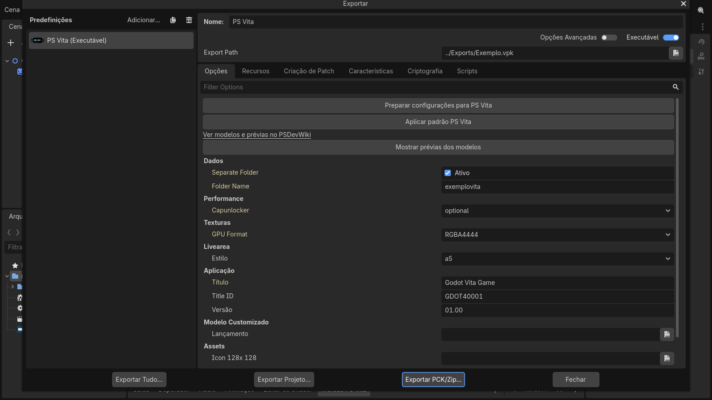
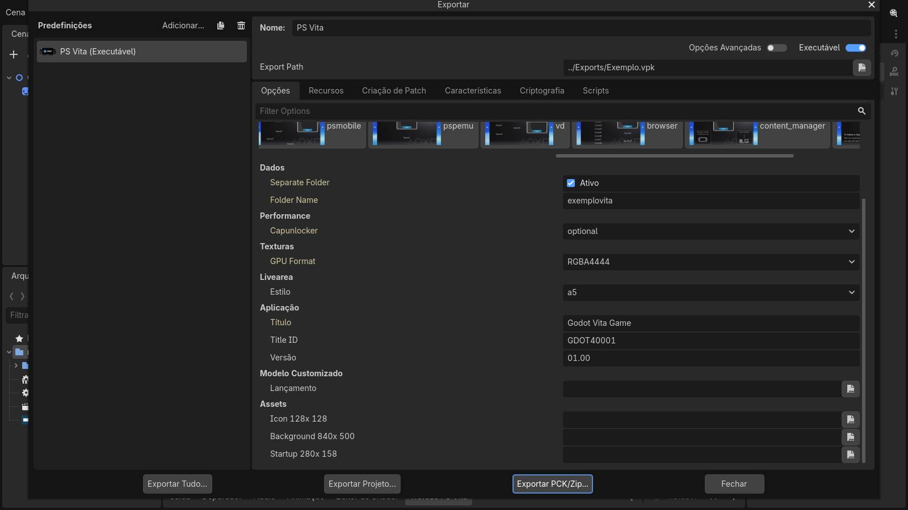
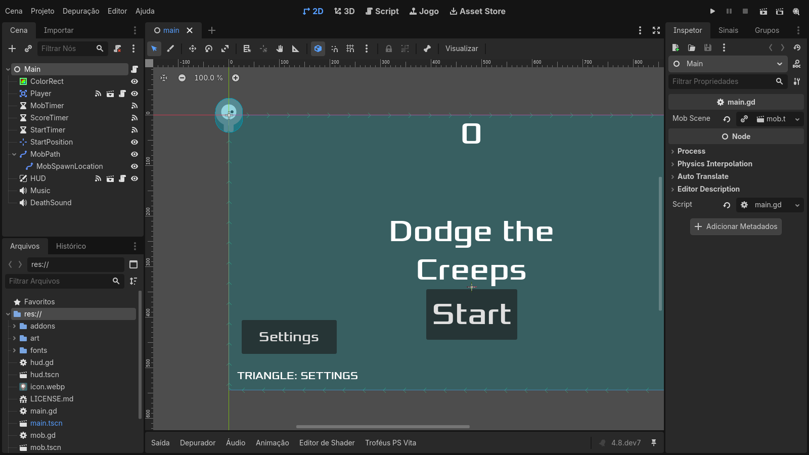
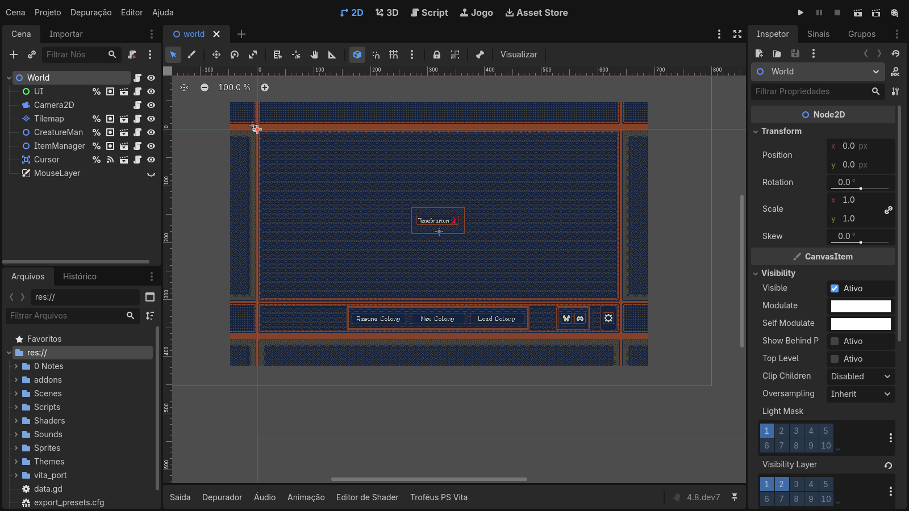
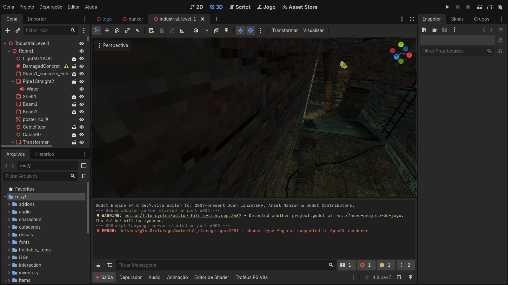
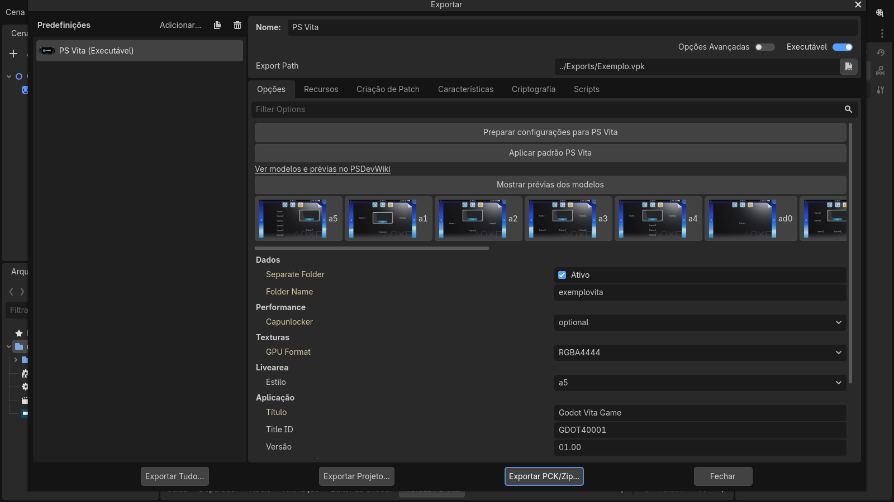
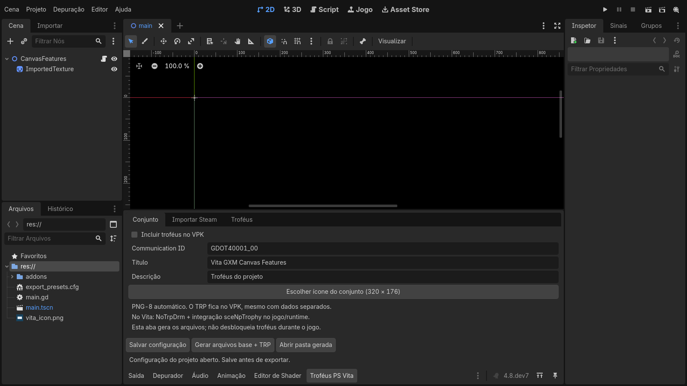
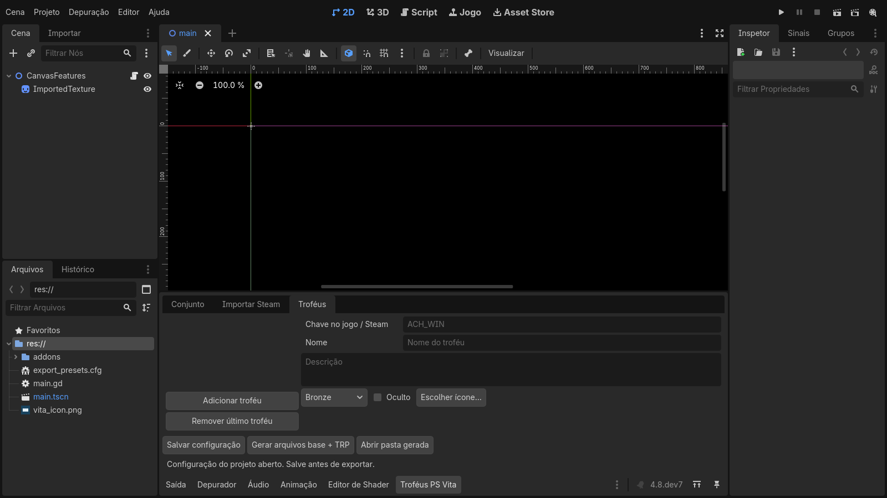

<p align="center">
  <picture>
    <source media="(prefers-color-scheme: dark)" srcset="docs/images/Godot4Vita-White.png">
    <source media="(prefers-color-scheme: light)" srcset="docs/images/Godot4Vita-Black.png">
    
  </picture>
</p>
<h1 align="center">GODOT 4 VITA</h1>

<p align="center">
  <strong>An experimental port of Godot 4.X to PlayStation Vita</strong>
</p>

<p align="center">
  <em>A custom Godot 4.8-dev7 runtime with native GXM rendering, plus a Windows editor that exports PS Vita VPKs directly.<br>
  This is not an official Godot release.</em>
</p>

<div align="center">
  <a href="https://github.com/WolffsRoom/godot4-psvita/releases/latest"></a>
  
  
  
</div>
<br>
<div align="center">
  <i>If you enjoy my work, consider supporting the development!</i>
  <br
  <a href="https://www.buymeacoffee.com/5rsrt7j4z8f">
    
  </a>
</div>

---


<h2 align="center">Table of Contents</h2>

<details open>
<summary><b>Overview and Features</b></summary>

- [Default Game Loading Screen](#default-game-loading-screen)
- [What This Project Is](#what-this-project-is)
- [Windows Editor with PS Vita Export](#windows-editor-with-ps-vita-export)
- [LiveArea Template Selection with Previews](#livearea-template-selection-with-previews)
- [PS Vita Trophies (In Development)](#ps-vita-trophies-in-development)

</details>

<details open>
<summary><b>Engine and Architecture</b></summary>

- [Runtime Architecture](#runtime-architecture)
- [Native GXM 2D Renderer](#native-gxm-2d-renderer)
- [Experimental GXM 3D Renderer](#experimental-gxm-3d-renderer)
- [Audio, Input, Memory and Data Loading](#audio-input-memory-and-data-loading)

</details>

<details open>
<summary><b>Getting Started</b></summary>

- [Games Running on This Engine](#games-running-on-this-engine)
- [Download and Quick Start](#download-and-quick-start)
- [Limitations](#limitations)

</details>

<details open>
<summary><b>Development and Resources</b></summary>

- [Building from Source](#building-from-source)
- [Repository Structure](#repository-structure)
- [Credits](#credits)

</details>


---

## Default game loading screen

Every game exported with this engine opens with the same native loading animation. After the LiveArea `pic0`, the Vita loader shows this 960 × 544 animation **while `libgodot.so` is being loaded and relocated**, before the engine itself exists. It replaces the black screen that used to last several seconds.

<p align="center">
  
</p>

How it works:

- The animation is adapted from Godot's official `custom_splash_screen` demo (MIT). It was rendered offline into a **DVAN** sequence: 180 PNG frames, 30 FPS, six seconds (`platform/vita/loader/boot_assets/custom_splash_960x544.dat`, packaged as `app0:boot_anim.dat`).
- The loader does not run GDScript or Godot resources at that point, so the animation is drawn by plain C code straight to a CPU framebuffer with `sceDisplaySetFrameBuf`, without `vita2d_init`.
- **Two decoder threads** (cores 1 and 2) decode PNG frames into a ring of four CDRAM buffers, while core 0 keeps loading the engine. A presenter shows frames strictly in order at up to 30 FPS (one decoder used to reach only ~15–20 FPS).
- The first cycle always completes. When the engine is ready, the display is blanked, the buffers are released and Godot's GXM renderer takes over.
- Godot's own project boot splash (`application/boot_splash`) is then drawn by the GXM renderer while scripts and the main scene load, instead of a black screen.
- The canonical animation is part of the export template; game-specific animations are refused by the template builder. Diagnostic builds can disable it with `-DVITA_BOOT_ANIMATION:FILEPATH=OFF`.

---

## What this project is

Godot 4 does not run on the PS Vita out of the box: the Vita has a 444 MHz quad-core ARM Cortex-A9, an SGX543 GPU driven through Sony's **GXM** API, 512 MB of RAM and no Vulkan or desktop OpenGL. This port has three parts:

| Part | What it does |
|---|---|
| **Runtime** (`platform/vita`) | Godot 4.8-dev7 compiled for ARM as a position-independent `libgodot.so`, with a Vita OS layer, native GXM 2D/3D renderers, audio, input and file access. |
| **Loader** (`platform/vita/loader`) | A small Vita `eboot.bin` that maps, relocates and starts `libgodot.so`, resolves its imports against the Vita SDK, shows the loading animation and manages CapUnlocker, logs and data paths. |
| **Windows editor** (`modules/vita_editor` + `platform/vita/editor`) | A Godot 4.8-dev7 Windows editor build in which **PS Vita is a built-in export platform**. It turns any compatible project into an installable VPK, with LiveArea, trophies and a separate data folder. |

---

## Windows editor with PS Vita export

The release ships **`Godot4Vita.exe`**, a portable Windows editor. PS Vita appears in **Project > Export > Add…** for every project, without installing an addon, Python, WSL or VitaSDK.

<p align="center">
  
</p>

### How the export platform was integrated

- **`modules/vita_editor`** is a small engine module compiled only into the Windows editor. At editor startup it registers a native `EditorPlugin` that loads three scripts from the `vita/` folder beside the executable: the export platform (`platform.gd`, an `EditorExportPlatformExtension`), an inspector plugin (`defaults_inspector.gd`) and the trophy panel (`trophy_panel.gd`). Keeping the logic in scripts beside the exe lets the export pipeline be updated without recompiling the editor.
- The same scripts also work as a classic addon (`addons/psvita`) for the official 4.8-dev7 editor. When the native plugin is present, the addon detects it and does not register a second platform.
- **Preset validation** checks the title, a 9-character Title ID, version `NN.NN`, the Compatibility renderer, a 960 × 544 viewport, the worker-thread count, the script export mode (text scripts) and the presence of the template. **Prepare settings for PS Vita** writes the required Vita overrides into the project; **Apply PS Vita defaults** restores the default images and the `a5` LiveArea.
- **Export** uses Godot's own resource exporter, so scenes are remapped and textures, fonts and audio are taken from `.godot/imported`. The Vita never imports assets. The runtime template (`vita/templates/vita_release.zip`) contains the loader, `libgodot.so`, the boot animation and a manifest with SHA-256 hashes; hashes are verified before packaging, and the destination VPK is only replaced after a successful build.
- `PARAM.SFO`, the LiveArea XML and the VPK are generated in GDScript, with no external tools. Export is always Release; **Export With Debug** is accepted but produces a Release package.

### Export options

| Option | Effect |
|---|---|
| **Data > Separate Folder** (default on) | The VPK contains the runtime and LiveArea; the game data goes into a folder next to it, which you copy to `ux0:data/<Folder Name>/`. Re-installing a large game no longer requires rebuilding a huge VPK. Turn it off to put everything inside the VPK. Earlier exports are kept with a `.previous-…` suffix. |
| **Performance > CapUnlocker** | `disabled`, `optional` (uses the fourth CPU core when the CapUnlocker plugin is installed) or `required` (shows instructions and exits when missing). When available, the audio mixer can run on the reserved core. |
| **Textures > GPU Format** | `RGBA4444` (default, half the GPU memory and transfer size) or `RGBA8888` (full precision for gradients and soft alpha). The conversion happens when the loader uploads each texture; project files are not changed. |
| **LiveArea > Style** | The `template.xml` layout, with visual previews (see below). |
| **Application** | Title, Title ID and version written to `PARAM.SFO`. |
| **Custom Template / Assets** | Optional custom runtime template and 8-bit indexed PNG images: icon 128 × 128, background 840 × 500 and startup button 280 × 158. Empty fields use the bundled Godot Vita images. |

<p align="center">
  
</p>

### Projects opened in the editor

The same editor opens and exports the ported games. These projects were adapted for the Vita runtime (960 × 544 viewport, Compatibility renderer, PS Vita preset) and open normally on the PC:

<p align="center">
  
  <br><em>Dodge the Creeps (2D, the engine's first test game)</em>
</p>
<p align="center">
  
  <br><em>Tenebrarium (2D, native GXM canvas with NinePatch and polygons)</em>
</p>
<p align="center">
  
  <br><em>OVERBURDEN (first 3D port, experimental GXM 3D)</em>
</p>

### Example export

[`examples/vita_export`](examples/vita_export) contains a minimal project, the `Exemplo.vpk` exported from it and its `ux0:data/exemplovita` data folder. Use it as a reference for the expected VPK and data layout, or install it to check that a Vita is ready for this runtime.

---

## LiveArea template selection with previews

The LiveArea is the Vita home screen page of a game. Its layout is defined by `sce_sys/livearea/contents/template.xml`. The export preset exposes the **LiveArea > Style** list (`a1`–`a5` for games, plus the other system layouts for reference) and **Show template previews**, a horizontally scrolling strip with a picture of each layout, so the right `template.xml` can be chosen without guessing.

<p align="center">
  
</p>

- The exporter writes a `template.xml` matching the selected style, with the background and startup images, and validates that game styles are used for games.
- Previews come from PSDevWiki (GFDL 1.2, see `previews/ATTRIBUTION.md`) and are shipped with the editor.
- Icon, background and startup images must be **8-bit indexed PNG** (palette PNG, not RGB/RGBA) with exactly the sizes of the default files: `icon0.png` 128 × 128, `bg0.png` 840 × 500 and `startup.png` 280 × 158. Use the bundled defaults in `vita/defaults/` as the format reference; the exporter rejects images that do not match.

---

## PS Vita trophies (in development)

A **PS Vita Trophies** tab is added to the editor's bottom panel. It builds a real trophy package for the VPK.

<p align="center">
  
  
</p>

1. **Set**: enables trophies in the VPK and sets the title, description and Communication ID (defaults to the Title ID + `_00`).
2. **Import Steam**: imports a game's achievements from the Steam Web API (`GetSchemaForGame/v2`) with a user key, or from a saved JSON response. Names, descriptions, hidden flags and icons are imported; re-importing keeps existing IDs and edits. The key is only kept for the session.
3. **Trophies**: edit each trophy's key, name, description, grade (Bronze/Silver/Gold/Platinum), visibility and icon, or add trophies manually.

**Generate base files + TRP** writes `vita_trophies/` in the project (`TROPCONF.SFM`, `TROP.SFM`, 8-bit PNG icons at 320 × 176 and 240 × 240, an achievement-to-trophy map) and a **TRP v2** container (64-byte big-endian entries, 16-byte aligned data, SHA-1). The exporter regenerates the TRP and places it at `sce_sys/trophy/<COMMUNICATION_ID>/TROPHY.TRP` in both data modes. Packages are unsigned and intended for [NoTrpDrm](https://github.com/Rinnegatamante/NoTrpDrm).

> [!NOTE]
> Status: the editor panel, Steam schema import, PNG-8 conversion, TRP generation and VPK packaging are implemented and tested on Windows. **The runtime unlock bridge (`sceNpTrophy`) is not implemented yet**, so games cannot unlock trophies in this release.

---

## Runtime architecture

```
eboot.bin (loader, C)                      libgodot.so (Godot 4.8-dev7, C++)
├─ boot animation (2 decoder threads)      ├─ OS_Vita / DisplayServerVita
├─ ELF loader + relocations (so_util)      ├─ RasterizerGXMVita (2D canvas, 3D scene)
├─ default_dynlib: SDK import table        ├─ AudioDriverVita (SceAudio)
├─ GXM bridge (vita2d + GXM programs)  ◄───┤ JoypadVita + front touch
├─ CapUnlocker probe / logs                └─ godot_vita.cpp entry: data folder + game.pck
└─ game_data/  or  ux0:data/<folder>/
```

- **Why a shared library:** the engine is built once as a PIC `libgodot.so` with unresolved SDK imports. The loader resolves those imports from its own table (`default_dynlib.c`), applies relocations and jumps into Godot. This avoids linking the whole engine into one huge eboot and lets the same runtime be reused by every game.
- **Memory:** the package requests the extended application budget (`ATTRIBUTE2=12`, about 365 MiB of user memory), a large newlib heap for Godot, and leaves CDRAM to the GPU. Free memory is logged periodically (`[vita-memory]`).
- **Clocks:** CPU 444 MHz, bus 222 MHz, GPU 222 MHz.
- **Stability:** a `WorkerThreadPool` out-of-range crash, decoded from a real Vita coredump, was fixed; projects use two worker threads. A PSP2 coredump analyzer is in `platform/vita/tools/analyze_psp2_core.py`.

---

## Native GXM 2D renderer

Godot's Compatibility renderer relies on GLES3 shaders that the Vita's shader compiler cannot handle reliably. Instead, `rasterizer_gxm_vita.cpp` + `gxm_canvas_vita.inc` translate Godot **CanvasItem** commands directly into GXM draws through a pinned [libvita2d](https://github.com/xerpi/libvita2d) context. No GLES shaders are used for 2D.

Implemented and validated in real games:

- Rectangles, sprites, atlas/texture regions, flips, transposes, transforms, modulation and tinting, clipping (`clip_children`, `clip_ignore`).
- **NinePatch** (StyleBoxTexture panels), **polygons** (StyleBoxFlat, `draw_circle`, `draw_polyline`), primitives and lines, tiled rectangles.
- Bitmap/atlas fonts and the bundled default font (Lato).
- **SubViewport render targets**: an offscreen GXM scene is rendered before the main scene and used as a texture (used for Tenebrarium's magnifier).
- **Draw batching**: consecutive quads that share texture, filter and tint are merged into one draw; redundant clip changes are skipped. Per-frame statistics are logged as `[gxm2d-perf]`.
- A 4 MiB vertex pool (the vita2d default of 1 MiB silently dropped draws in tile-heavy scenes).
- **CPU/GPU overlap**: the CPU builds the next frame (scripts, physics) while the GPU renders the current one; vertices and retired textures are released only when that frame is done.
- Textures uploaded as RGBA4444 or RGBA8888 (see export options), with a 64 MiB texture budget.
- Viewport scaling to 960 × 544, optional aspect preservation (`rendering/vita/keep_aspect`) and project boot-splash display.

Validated on hardware with [Dodge the Creeps](https://github.com/WolffsRoom/DodgeTheCreeps-PSVita), [Ambidextro](https://github.com/WolffsRoom/Ambidextro-Vita), Deltarune Lightners Live Plus and [Tenebrarium](https://github.com/WolffsRoom/TenebrariumVita).

---

## Experimental GXM 3D renderer

`rasterizer_scene_gxm_vita.inc` (built into `libgodot_gxm3d.so`, enabled at run time by `gxm3d.cfg`) draws Godot **MeshInstance3D** scenes with GXM, sharing the 2D canvas for UI. It is used by the Overburden port and by the Buckshot Roulette validation.

- Static and skinned meshes (CPU skinning), textured materials with alpha, a mesh arena in GPU memory, depth testing.
- Per-vertex lighting in a second multiplicative pass, light flares, additive blending, decals without depth writes.
- Distance and screen-size culling with hysteresis (`gxm_camera_lod.h`), a configurable triangle budget and distance darkening.
- Tuning through project settings: `rendering/vita/triangle_budget`, `vertex_lighting`, `per_object_lighting`, `light_floor`, `light_flares`, `distance_darkening`, `shadow_rays`, `brightness`.

Not available yet: real-time shadow maps, fog, screen-space effects, custom spatial shaders and post-processing.

---

## Audio, input, memory and data loading

- **Audio:** Godot's AudioServer mixes as usual; the Vita driver sends PCM16 to SceAudio. The default `audio/vita/output_mode="godot3"` reproduces the layout of the Godot 3 Vita driver that plays without distortion on hardware (BGM port, project mix rate, 512-frame blocks). `main48` keeps the earlier 48 kHz / 2048-frame layout. See [AUDIO_BACKEND.md](platform/vita/AUDIO_BACKEND.md).
- **Input:** D-pad, both analog sticks, face buttons, shoulders, START/SELECT as Godot joypad 0, plus **front touch screen** events.
- **Data loading:** the runtime reads `app0:game_data_folder.cfg` to find `ux0:data/<folder>/game_data`. If a **`game.pck`** is present it is mounted with `--main-pack`; every loose file on `ux0:` costs a directory lookup (about 150 ms measured per resource), so one pack loads much faster. Logs are written to `ux0:data/<folder>/logs/`.

---

## Games running on this engine

| Game | Type | Status |
|---|---|---|
| [Dodge the Creeps](https://github.com/WolffsRoom/DodgeTheCreeps-PSVita) | 2D, Godot's official demo | **First game on the engine.** Gameplay, collisions, HUD, audio and controls confirmed on a physical Vita. |
| [Ambidextro](https://github.com/WolffsRoom/Ambidextro-Vita) | 2D commercial game | Beta release; playable on hardware with the native GXM 2D renderer. |
| Deltarune Lightners Live Plus | 2D fan game | Runs on hardware; used to validate `game.pck` loading and the audio fixes. |
| [Tenebrarium](https://github.com/WolffsRoom/TenebrariumVita) | 2D | Alpha; runs on hardware. Drove NinePatch, polygons, SubViewport, batching and touch support. |
| [OVERBURDEN](https://github.com/WolffsRoom/OVERBURDEN-Vita) | **First 3D game** | In development; full game playable on hardware at ~30 FPS with the experimental GXM 3D renderer. |
| Buckshot Roulette | 3D | Internal validation of the 3D limits: boots, main menu and options work; gameplay does not start yet because of the complexity of its 3D scene. |

---

## Download and quick start

1. Download **`Godot4Vita-v0.1-Windows-x64.zip`** from the [latest release](https://github.com/WolffsRoom/godot4-psvita/releases/latest) and extract the whole folder. Keep `vita/` next to `Godot4Vita.exe`.
2. Open or create a project. In **Project > Export > Add…** choose **PS Vita** and click **Prepare settings for PS Vita**.
3. Set the title, a unique 9-character Title ID and the version, choose the LiveArea style and the data folder name.
4. Click **Export Project** and save the `.vpk`.
5. On the Vita (HENkaku/Ensō with kubridge installed), install the VPK with VitaShell and copy the generated data folder to `ux0:data/`.

The PS Vita export and trophy panels are currently labelled in Portuguese (for example **Preparar configurações para PS Vita**, **Mostrar prévias dos modelos**, **Troféus PS Vita**). The `Exemplo/` project in the release is a ready-to-export example. Detailed Portuguese guides are included: `LEIA-ME.md`, `TROFEUS.md`, `RGBA4444.md`.

---

## Limitations

- Canvas 2D is a subset: CanvasItem shaders/materials, CanvasGroup effects, GPU particles and some text modes are not rendered (unsupported materials fall back to unshaded drawing).
- 3D is experimental (see above); performance and memory must be checked per game.
- No C#, GDExtension or remote debugging on the Vita. Scripts are exported as text.
- The runtime is pinned to **Godot 4.8-dev7**; projects from other 4.x versions usually open after conversion, but the template is not interchangeable with other engine builds.
- Trophies are packaged but not unlocked at run time yet.
- The Windows editor uses the desktop Compatibility renderer; what you see on the PC is not a Vita emulator.

---

## Building from source

**Requirements:** Linux/WSL, [VitaSDK](https://vitasdk.org), Python 3, SCons, CMake, the patched [VitaGL](https://github.com/Rinnegatamante/vitagl) build described in [platform/vita/vitagl](platform/vita/vitagl/README.md), and MinGW-w64 (POSIX threads) for the Windows editor.

Runtime, loader and export template (WSL):

```bash
export VITASDK=/usr/local/vitasdk
platform/vita/tools/build_release_template.sh /path/to/vitagl /path/to/output
# -> libgodot.so, loader/godot_loader.vpk, vita_release.zip
```

Windows editor (WSL with MinGW), then assemble the portable folder (Windows Python):

```bash
platform/vita/tools/build_windows_editor.sh
python platform/vita/tools/package_windows_editor.py
python platform/vita/tools/archive_windows_editor.py
```

See [BUILDING.md](platform/vita/BUILDING.md), [INTEGRATED_WINDOWS.md](platform/vita/editor/INTEGRATED_WINDOWS.md) and [GXM_BACKEND.md](platform/vita/GXM_BACKEND.md).

---

## Repository structure

| Path | Purpose |
|---|---|
| `platform/vita/` | Vita OS, display, input, audio and file access |
| `platform/vita/rasterizer_gxm_vita.cpp`, `gxm_canvas_vita.inc` | Native GXM 2D renderer |
| `platform/vita/rasterizer_scene_gxm_vita.inc`, `godot_vita_gxm3d.cpp` | Experimental GXM 3D renderer and its entry point |
| `platform/vita/loader/` | Loader, ELF relocation, SDK import table, GXM bridge, boot animation |
| `platform/vita/editor/addons/psvita/` | Export platform, LiveArea previews, trophy tools (GDScript) |
| `modules/vita_editor/` | Native editor plugin that registers PS Vita in the Windows editor |
| `platform/vita/tools/` | Build, packaging, template, validation and coredump tools |
| `platform/vita/tests/` | ColorRect, canvas, 3D mesh and Dodge the Creeps test projects |

---

## Credits

- [Godot Engine](https://github.com/godotengine/godot) for upstream engine ([README.godot.md](README.godot.md)); loading animation adapted from the official `custom_splash_screen` demo.
- [VitaSDK](https://vitasdk.org), [VitaGL](https://github.com/Rinnegatamante/vitagl), [libvita2d](https://github.com/xerpi/libvita2d), [kuBridge](https://github.com/TheOfficialFloW/kuBridge), [NoTrpDrm](https://github.com/Rinnegatamante/NoTrpDrm).
- [SonicMastr/godot-vita](https://github.com/SonicMastr/godot-vita) for Godot 3.x Vita port reference.
- LiveArea layout previews: [PSDevWiki](https://www.psdevwiki.com/vita/) (GFDL 1.2).

_Godot engine code and port additions are provided under the [MIT license](LICENSE.txt); third-party components retain their respective licenses._
